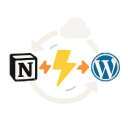

**🏠 Home** • [📚 User Guide](docs/Wiki.md) • [📊 Project Overview](docs/PROJECT_OVERVIEW.md) • [🚀 Developer Guide](docs/DEVELOPER_GUIDE.md) • [🔄 Changelog](https://github.com/Frank-Loong/Notion-to-WordPress/commits)

**🌐 Language:** **English** • [中文](README-zh_CN.md)

---

#  Notion-to-WordPress

🚀 Transform Notion into WordPress with one click — Say goodbye to copy-pasting and achieve fully automated content publishing and synchronization

  

## Overview
**Notion-to-WordPress** is a modern WP plugin that syncs every block of your Notion database—posts, pages, images, math, Mermaid charts—straight to WordPress and keeps them in perfect harmony.

*Write in Notion, rank with WordPress. Stop copying, start creating.*

## 🖼️ Demo Showcase

   
  <em>▲ Intuitive plugin admin panel: configure, sync, and monitor with ease</em>

   
  <em>▲ Write and organize content in Notion — your familiar workspace</em>

   
  <em>▲ One-click sync: Notion content instantly published to WordPress, pixel-perfect</em>

## Highlights
- **⚡ Lightning-fast import** – manual, one-click refresh, scheduled Cron, or instant Webhook
- **🧠 Smart incremental sync** – only syncs changed content for optimal performance
- **🔄 Triple sync modes** – Manual control + Automated scheduling + Real-time webhooks
- **🗑️ Intelligent deletion detection** – automatically cleans up removed Notion pages
- **🧠 Visual field mapping** – bind Notion properties to categories, tags, custom fields & featured image
- **📐 Pixel-perfect rendering** – KaTeX math, mhchem, Mermaid flow & sequence diagrams out-of-the-box
- **🔒 Secure by design** – nonce + capability checks, strict CSP, MIME & size validation for downloads
- **🗂 Fits every scenario** – blogs, knowledge bases, course sites, team collaboration, you name it
- **🌍 Multilingual** – i18n built-in (English & Simplified Chinese)
- **📝 Clean uninstall** – optional removal of settings, logs & imported content

> Need help or dive deeper? Visit the [User Guide 📚](./docs/Wiki.md) – English | [中文](./docs/Wiki.zh_CN.md), which includes templates, screenshots, and troubleshooting. 

## Quick Start

### 🚀 3-Step Setup
1. **Install** – upload the ZIP in `Plugins → Add New` and activate
2. **Configure** – get your Notion API token and database ID
3. **Sync** – click "Manual Sync" and watch your content appear in WordPress!

## 🚀 Key Features

### **Triple Sync Modes**
- **🖱️ Manual Sync** – On-demand control with instant feedback
- **⏰ Scheduled Sync** – Automated background processing
- **⚡ Webhook Sync** – Real-time updates as you type in Notion

### **Smart Technology**
- **Incremental Sync** – Only processes changed content
- **Intelligent Deletion** – Auto-cleanup of removed pages
- **Rich Content Support** – Math, diagrams, images, and more

## 💡 Use Cases
### **Content Creation**
- **Blogs & News Sites** – Write in Notion's familiar interface, publish to WordPress automatically
- **Knowledge Bases** – Create organized documentation with Notion's hierarchy
- **Team Collaboration** – Collaborative writing in Notion, professional publishing in WordPress
- **Online Courses** – Structure learning materials in Notion, deliver through WordPress

### **Publishing Workflow**
- **Real-time Publishing** – Webhook triggers instant sync when content changes
- **Scheduled Updates** – Queue content for future publishing
- **Draft Management** – Keep works-in-progress in Notion until ready

## 📈 Performance & Reliability

### **Production Ready**
- **Smart Sync** – Incremental technology for optimal performance
- **Large Scale** – Handles databases with 1000+ pages efficiently
- **Error Recovery** – Advanced error handling with detailed logging
- **Enterprise Grade** – Security hardened following WordPress standards

## Contributing ⭐
If this project helps you, please smash that **Star**! PRs, issues, translations and ideas are warmly welcome.

* [🚀 Developer Guide](./docs/DEVELOPER_GUIDE.md) - Complete development and contributing guide
* [Open an Issue](https://github.com/Frank-Loong/Notion-to-WordPress/issues)
* [Feature Requests](https://github.com/Frank-Loong/Notion-to-WordPress/discussions)

## Acknowledgments

This project was inspired by and references the following excellent open-source projects:

- **[NotionNext](https://github.com/tangly1024/NotionNext)** - A powerful static blog system based on Notion, providing valuable insights for Notion API integration and content processing
- **[Elog](https://github.com/LetTTGACO/elog)** - An open-source blog writing client that supports multiple platforms, offering great reference for multi-platform content synchronization
- **[notion-content](https://github.com/pchang78/notion-content)** - Content management solutions that helped shape our approach to Notion content handling

We extend our heartfelt gratitude to these projects and their maintainers for their contributions to the open-source community, which made this project possible.

## 📄 License

This project is open-source under the [GPL-3.0](LICENSE) license.

## 🌟 Star History

---

**[⬆️ Back to Top](#overview) • [📚 User Guide](docs/Wiki.md) • [📊 Project Overview](docs/PROJECT_OVERVIEW.md) • [🚀 Developer Guide](docs/DEVELOPER_GUIDE.md) • [🔄 Changelog](https://github.com/Frank-Loong/Notion-to-WordPress/commits)**

© 2025 Frank-Loong · Notion-to-WordPress v2.0.0-beta.2

